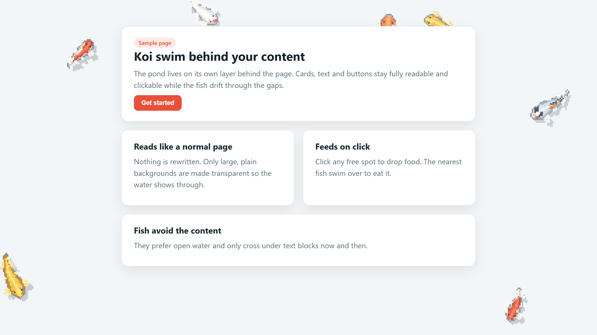
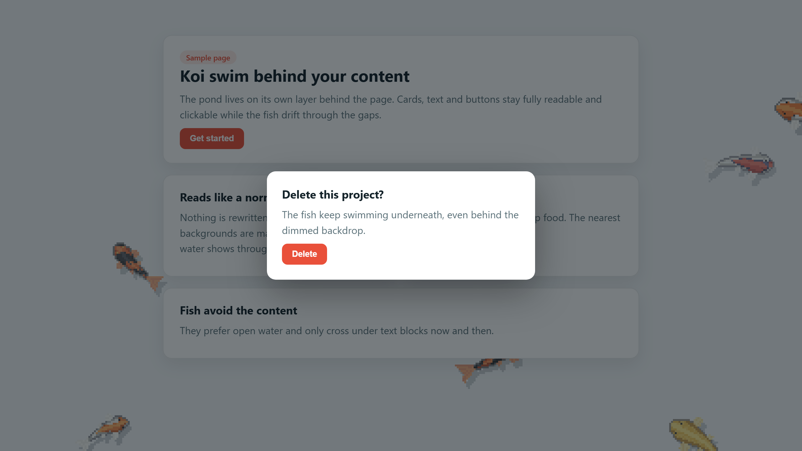
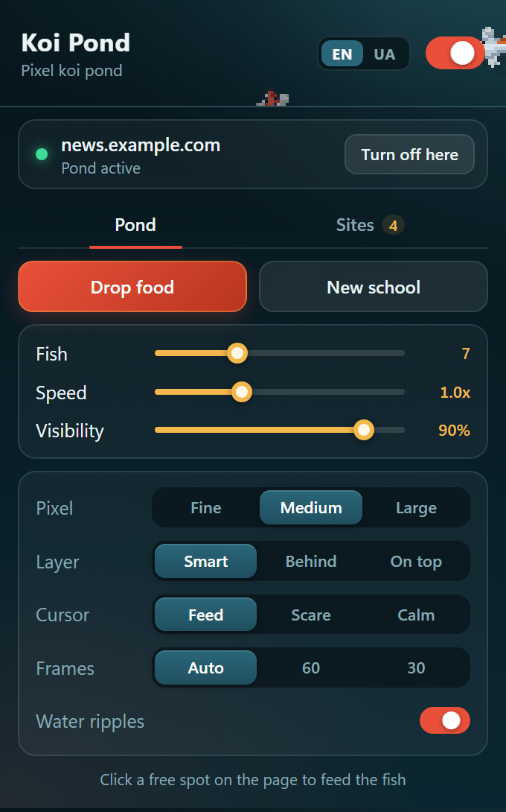
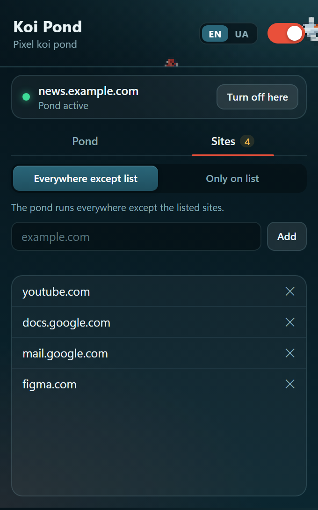

# 🎏 Koi Pond

A pixel-art koi pond that swims **behind** the web pages you browse, like the fish tanks in traditional Chinese restaurants. Extension for Chrome and Edge.

<p align="center">
  
</p>

The fish live on their own layer behind the page, so text, cards and buttons stay readable and clickable. The koi drift through the open space, slip under content now and then, and swim over to food you drop with a click.

## Features

- 15 koi varieties drawn in pixel art, each with its own pattern.
- Feed the fish by clicking a free spot, or scare them with the cursor.
- Adapts to the page: fish prefer open water, the school shrinks on crowded pages, and the pond pauses when there is no room.
- Keeps swimming under the dimmed backdrop of modal dialogs.
- Works on light and dark pages.
- Blacklist or whitelist of sites.
- Light on resources: about 1–2 ms per frame for 7 fish.

<table>
  <tr>
    <td width="50%"></td>
    <td width="50%"></td>
  </tr>
</table>

## Install

The extension is not on the Chrome Web Store, so load it unpacked:

1. Download or clone this repository.
2. Open `chrome://extensions` (or `edge://extensions`) and turn on **Developer mode**.
3. Click **Load unpacked** and choose the folder with `manifest.json`.

## Settings

Click the toolbar icon. The panel is in Ukrainian.

<table>
  <tr>
    <td width="50%"></td>
    <td width="50%"></td>
  </tr>
</table>

You can change the number of fish, speed, visibility, pixel size, frame rate, cursor behavior (feed / scare / calm) and the layer mode (smart / behind / on top). The **Sites** tab holds the blacklist or whitelist.

## Privacy

The extension makes no network requests and collects nothing. Settings are stored with `chrome.storage.sync`.

## Development

Plain JavaScript, no build step. Run the tests with Node.js 18+:

```bash
npm test
```

## License

[MIT](LICENSE)
