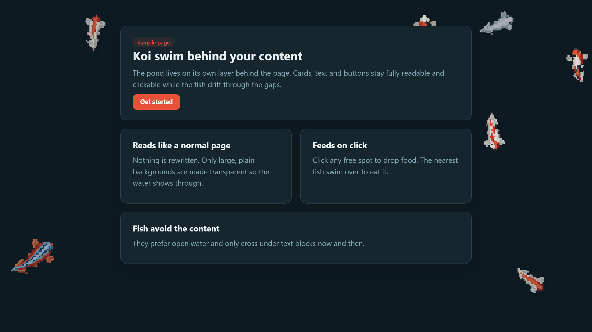

# 🎏 Koi Pond

**A living pixel-art koi pond that swims behind the web pages you browse**, like the fish tanks in traditional Chinese restaurants. A Manifest V3 extension for Chrome and Edge.

<p align="center">
  
</p>

The fish live on their own layer *behind* the page. Text, cards and buttons stay fully readable and clickable, while the koi drift through the open space around them, slip under content now and then, and swim over to eat food you drop with a click.

## Features

- **15 koi varieties** drawn procedurally in pixel art: Kohaku, Sanke, Showa, Tancho, Asagi, Shusui, Kujaku, Goromo, Utsuri, Ogon, Shubunkin and more, each with its own pattern, fins and shading.
- **Smart layering.** The pond sits behind the page. Large plain backgrounds are made transparent so the water shows through; cards, text and media are left alone. Fish prefer open water and only cross under content occasionally.
- **Feeding and play.** Click a free spot to drop food, or switch the cursor to *scare* mode and watch the school scatter. Ripples spread across the water.
- **Fits any page.** With little free space the school shrinks to fit, and when there is almost none the pond pauses by itself and returns when room appears.
- **Works with modal dialogs.** Fish keep swimming under the dimmed backdrop of a modal, both for custom overlays and the native `<dialog>`.
- **Light and dark pages.** The water ripples adapt to the page's theme.
- **Site lists.** Run everywhere except a blacklist, or only on a whitelist. An entry covers the site and all its subdomains.
- **Light on resources.** Seven fish cost roughly 1–2 ms per frame; hidden tabs and paused ponds do no work at all (see [Performance](#performance)).

<table>
  <tr>
    <td width="50%"></td>
    <td width="50%"></td>
  </tr>
  <tr>
    <td align="center"><sub>Dark pages get matching ripples</sub></td>
    <td align="center"><sub>Fish keep swimming around and under a modal</sub></td>
  </tr>
</table>

## Install

The extension is not on the Chrome Web Store yet, so load it unpacked:

1. Download or clone this repository.
2. Open `chrome://extensions` (or `edge://extensions`).
3. Turn on **Developer mode**.
4. Click **Load unpacked** and choose the folder that contains `manifest.json`.
5. Open any website. The pond appears behind the page.

Pages that already have the extension loaded need a refresh (F5) after you install or reload it.

## Using it

Click the toolbar icon to open the control panel. Its interface is in Ukrainian.

<table>
  <tr>
    <td width="50%"></td>
    <td width="50%"></td>
  </tr>
  <tr>
    <td align="center"><sub><b>Pond</b>: feed, respawn, sliders and modes</sub></td>
    <td align="center"><sub><b>Sites</b>: blacklist and whitelist</sub></td>
  </tr>
</table>

| Setting | Options |
|---|---|
| Fish | 1–20 |
| Speed | 0.4×–2.2× |
| Visibility | 25–100% |
| Pixel size | small / medium / large (2–4 screen pixels per art pixel) |
| Layer | **Smart** (behind the page, adapts backgrounds), **Behind** (page untouched, visible where transparent), **On top** (over the page, clicks pass through) |
| Cursor | **Feed** on click, **Scare** on hover, or **Calm** |
| Frame rate | Auto (60, or 30 when saving power), 60, 30 |
| Ripples | on / off |
| Sites | everywhere except the list, or only the list |

The header of the panel is a tiny live pond running the same simulation as the pages.

## Privacy

- No network requests. Nothing is collected, sent or stored outside your browser.
- Settings (including your site lists) are saved with `chrome.storage.sync`, which Chrome may sync across your own signed-in devices.
- Permissions: `storage` for settings and `activeTab` so the panel can talk to the current tab. The content script runs on all pages because the pond has to be able to appear anywhere; use the site lists to limit that.
- The pond only runs in top-level pages, never inside embedded frames.

## Performance

Measured on one desktop machine with synthetic pages. Treat the numbers as orders of magnitude, not guarantees.

| | Cost |
|---|---|
| One animation frame, 1 / 7 / 20 fish | ~0.2 / ~1.2–1.5 / ~3.6 ms (budget at 60 fps: 16.7 ms) |
| Script start-up per page (111 KB) | < 4 ms |
| Page scan after load, 1.7k / 8.4k / 28k elements | ~17 / ~33 / ~82 ms, once |
| Re-scan after page changes | ~6 ms, at most once per 0.9–4 s |

Hidden tabs and paused ponds draw nothing. If you want it lighter still, set the frame rate to 30, use fewer fish or a larger pixel size, or add heavy web apps to the blacklist.

## How it works

- **Layering.** A shadow-DOM host with a single `<canvas>` is pinned behind the page (`z-index: -1`, `pointer-events: none`). In *Smart* mode a bounded scan of the DOM makes large, plain page backgrounds transparent and gives the host the same color underneath, then restores everything when the pond stops.
- **Open-water map.** A 16×10 grid samples what is actually visible at each point (media, background images, opaque areas, text blocks). The simulation turns it into a field that gently steers fish toward open water.
- **Fish.** Each koi is a 12-node spine that follows its head with a swimming wave. They keep their distance from each other, chase food, avoid the cursor in scare mode and occasionally take short trips under content.
- **Rendering.** Fish are rasterized into a small sprite atlas with pre-built pattern lookup tables and drawn with a single `drawImage` per fish.

More detail (in Ukrainian) is in [docs/DEVELOPMENT.uk.md](docs/DEVELOPMENT.uk.md).

## Development

No build step and no dependencies; the extension is plain JavaScript. You need Node.js 18+ for the tests.

```bash
npm test                      # unit tests (node:test)
node scripts/generate-icons.mjs   # regenerate the toolbar icons
```

`demo/preview.html` loads the same content scripts without installing the extension. Serve the folder over HTTP (for example `npx serve .`) and open `/demo/preview.html`.

```
manifest.json            Manifest V3
src/shared/              default settings, koi varieties, site-list logic
src/content/             layer manager, simulation, renderer, entry point
src/background/          service worker (toolbar badge, settings migration)
popup/                   control panel
tests/                   unit tests
scripts/                 icon generator
docs/                    screenshots and developer notes
```

## Known limitations

- Chrome and Edge only (Manifest V3). Not tested in Firefox or Safari.
- It does not run on `chrome://` pages, the Chrome Web Store or other pages where extensions are blocked.
- *Smart* mode relies on heuristics, so a few sites with unusual layouts may look better in *Behind* or *On top* mode, or on the blacklist.
- Fully opaque overlays (a very dark backdrop of 90% or more) count as covering the page and pause the pond.
- The control panel is currently Ukrainian only.

## License

[MIT](LICENSE)
